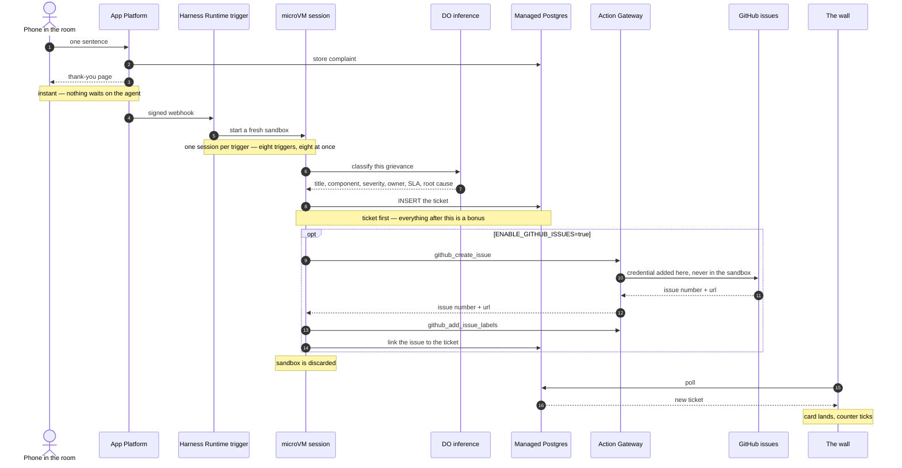
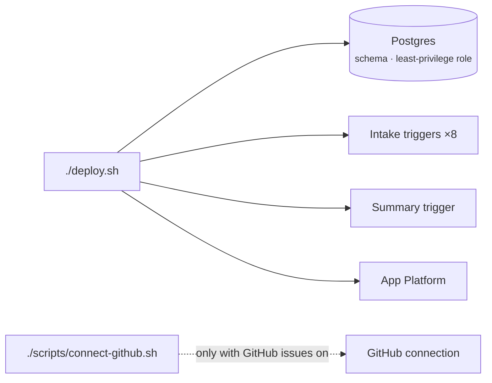

# Facility Issue Tracker

A live demo for DigitalOcean **Managed Agents Runtime Services** (Harness
Runtime).

A QR code points the room at a one-field form: *"Complain about anything. One
sentence."* Each submission starts its own microVM, where an agent files it as
a deadpan enterprise incident ticket. The room watches the tickets land on a
wall.

> *"The lift plays jazz."*
> → **P4** · Elevators & Vertical Transit · owner Facilities · SLA 168h
> **Unsolicited Ambient Music Genre Broadcast Within Vertical Transit Infrastructure**

Filing each ticket as a GitHub issue is **optional and off by default** — the
demo runs on the harness alone. See [GitHub issues](#github-issues-optional).

---

## How it works



- **Nothing on the request path waits for an agent.** The form answers
  instantly; the ticket appears on the wall 20–45 seconds later.
- **The executive summary is a second agent, same shape.** **Generate now**
  sends the ticket figures to a summary trigger; its microVM writes the
  summary to Postgres, and the dashboard picks it up.
- **The web app never calls the model.** Both agents run in sandboxes, and
  only they hold the model key.
- **Eight complaints at a time.** A trigger runs one session at a time, so
  `deploy.sh` creates a pool of eight and the app round-robins across them.
  Eight submitted together all finished within 89 seconds.

---

## Deploy

You need `doctl` (authenticated), Node 22+, `jq`, and a fork of this repo that
the DigitalOcean GitHub app can read. The fork is only where App Platform
builds from; filing issues is a separate, optional step
([below](#github-issues-optional)).

```bash
cp .env.example .env    # fill in the four REQUIRED values
./deploy.sh             # safe to re-run
./destroy.sh            # removes everything deploy.sh created
```



### Required

| Variable | What it is |
| --- | --- |
| `DIGITALOCEAN_ACCESS_TOKEN` | Your API token. Used by the scripts only. |
| `INFERENCE_API_KEY` | A [model access key](https://cloud.digitalocean.com/gen-ai/model-access-keys), **not** the API token. Given to the agents only. |
| `ADMIN_PASSWORD` | Password for `/admin`. |
| `GITHUB_REPO` | Your fork, as `owner/repo`. App Platform builds from it. |

### Optional

Changes take effect on the next `./deploy.sh`.

| Variable | Default | What it does |
| --- | --- | --- |
| `ENABLE_GITHUB_ISSUES` | `false` | `true`: each ticket also opens a labelled GitHub issue. See below. |
| `GITHUB_ISSUE_REPO` | — | Where issues go, as `owner/repo`. Required when GitHub issues are on. |
| `GITHUB_ISSUE_TOKEN` | — | Lets **Reset** delete the tracker's issues. See `.env.example`. |
| `AG_SCOPES` | `repo,read:user` | OAuth scopes `connect-github.sh` asks for. |
| `INFERENCE_MODEL` | `qwen3.8-max` | Model the agents use. `doctl serverless-inference models list` |
| `INFERENCE_BASE_URL` | `https://inference.do-ai.run` | DigitalOcean inference endpoint. |
| `STACK_NAME` | `facility-tracker-demo` | Name prefix for every resource. Lowercase letters, numbers and hyphens only. |
| `DO_REGION` | `nyc3` | Region for the app and database. |
| `INTAKE_SHARDS` | `8` | Complaints processed at once. |
| `APP_SIZE` / `DB_SIZE` | `basic-xxs` / `db-s-1vcpu-1gb` | Instance sizes. |
| `GITHUB_BRANCH` | `main` | Branch App Platform builds. |
| `PORT`, `NODE_ENV`, `SESSION_SECRET` | local defaults | Local runs only. |

### GitHub issues (optional)

Off by default: the demo is the harness alone, and the agent gets no GitHub
tools. To file an issue per ticket:

1. In `.env`, set `ENABLE_GITHUB_ISSUES=true` and `GITHUB_ISSUE_REPO` to a
   repo kept for this. **Reset deletes its issues.**
2. Run `./deploy.sh`.
3. Run `./scripts/connect-github.sh` and approve the link it prints (OAuth,
   so this step is yours).

The GitHub credential stays in Action Gateway and never enters a sandbox.
`./scripts/check-github.sh` reports whether issues are actually being filed.

---

## Run the demo

| Screen | URL |
| --- | --- |
| Project first | `/qr` — full-screen QR code |
| Project during | `/admin/wall` — the live wall |
| For you | `/admin` — dashboard, tickets, summary |

1. **Put the QR up** and let the room submit. Watch "In flight" rise and fall.
2. **Close with the executive summary.** Press **Generate now** on
   `/admin/summary` about 30 seconds before you want it: an agent writes it
   and it appears on its own.
3. **Reset demo** (next to Sign out) wipes the database before the next
   run-through. With GitHub issues on, it also deletes the tracker's issues.

**Close** on a ticket closes it in the app only.

**Rehearsing:** `node scripts/seed.js --fake -n 20` fills the wall instantly,
with no agents. Without `--fake` it runs the real pipeline.
`npm run db:reset -- --yes` wipes the database.

---

## Run locally

There is no local database: a local run uses the deployed cluster and
triggers, so submissions still start real microVMs. It is also your fallback
if the venue blocks the App Platform URL.

```bash
npm install
./scripts/link-local.sh > .env.local
npm run dev             # http://localhost:3000
```

To change an agent's behaviour, edit its prompt in `agents/`, then
`./deploy.sh`.

---

## Security at a glance

| Credential | Who holds it |
| --- | --- |
| DigitalOcean API token | The deploy scripts, on your machine |
| Model access key | The agents only |
| `mars_writer` database role | The agents. It can insert tickets and summaries and fill in a few status columns; it cannot read what anyone wrote, or delete. Checked on every deploy. |
| GitHub OAuth *(GitHub issues on only)* | Action Gateway, substituted when a tool runs |
| `GITHUB_ISSUE_TOKEN` *(GitHub issues on only)* | The web app, for Reset only |

- **Submissions are data, not instructions.** Attempts to give the agent
  orders get filed under `Human Factors`.
- **The ticket is written before anything else**, so a GitHub failure loses a
  link, never a ticket.
- **Authorize GitHub with the script, not the control panel.** Action Gateway
  matches connections by actor, and the script picks the right one.
- **The form is rate limited** to 8 submissions per IP per minute (`RATE_MAX` in the app spec).

